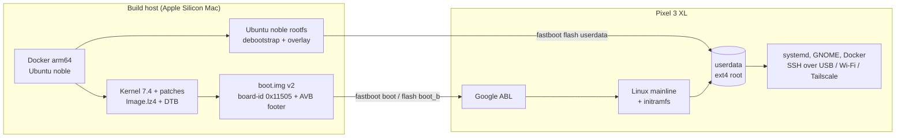

<div align="center">

# Ubuntu Mobile — Pixel 3 XL

**Native Ubuntu 24.04 LTS (arm64) on the Google Pixel 3 XL, running a mainline Linux kernel.**

No Android, no chroot: a full Ubuntu userspace with systemd, GNOME on the real AMOLED panel, Docker,
and reproducible build scripts.

-4285F4)


-4A86CF)


</div>

> **Warning.** Unlocking the bootloader wipes the device. Flashing the wrong partition can permanently brick it.
> Read the [safety rules](#safety-rules) before running any flash command.

---

## Overview

This repository documents and automates a working port of Ubuntu 24.04 to the Pixel 3 XL (`crosshatch`, Qualcomm SDM845):

- **Mainline kernel** `v7.4-rc2` with the Pixel 3 XL panel series (v3) and 14 additional patches, including a new
  USB Type-C/PD sink driver for the PMI8998 and several upstreamable bug fixes.
- **Touch-friendly GNOME 46** on the native display driver: touchscreen, on-screen keyboard (including Chrome),
  long-press context menus and display-cutout (notch) handling.
- **Battery management suitable for 24/7 use**: configurable charge limit, USB PD 9 V fast charging,
  temperature-based charge current (Google's stock table) and a battery-defender mode.
- **Connectivity**: SSH over USB (NCM gadget), Wi-Fi, Bluetooth, Tailscale, remote desktop (xrdp).
- **Server workloads**: Docker runs natively; idle power with the screen off is about 0.7 W.
- **Reproducibility**: every build, flash and configuration step is a script in [`scripts/`](scripts/);
  the build environment is an arm64 Docker image on Apple Silicon.

## Hardware support

| Component | Part | Status | Notes |
|---|---|---|---|
| CPU, cpufreq, thermal | SDM845 (4x Kryo 385 Gold + 4x Silver) | Working | no throttling under server load |
| Storage | 64 GB UFS | Working | root filesystem on `userdata` (ext4) |
| Display | 1440x2960 AMOLED, Samsung S6E3HA8 DDIC | Working | native panel driver; the panel must never be powered off (see below) |
| GPU | Adreno 630 (freedreno) | Working | hardware-accelerated GNOME Wayland |
| Touchscreen | Samsung S6SY761 | Working | device tree patch |
| Wi-Fi | WCN3990 (ath10k) | Working | firmware runs on the modem DSP |
| Bluetooth | WCN3990 | Working | requires a BD address service (`pixel-bt-addr`) |
| USB-C (device mode) | DWC3 | Working | NCM (network) + ACM (serial console) gadget |
| USB Power Delivery | PMI8998 Type-C + PD PHY | Working | new driver; sink PDOs 5 V/3 A and 9 V/2 A |
| Charger, fuel gauge | PMI8998 SMB2, MAX17201 | Working | percentage, temperature, charge limit, fast charging |
| Speakers | 2x Cirrus Logic CS35L36 | Working | PipeWire; hardware volume keys |
| Microphones | WCD9340 (SLIMbus) | Not working | codec and SLIMbus probe; captured samples are all zero |
| Front camera | Sony IMX355 | Partial | sensor detected at 0x10; no image yet (needs libcamera >= 0.3 soft ISP) |
| Rear camera | Sony IMX363 | Not working | no mainline driver |
| Haptics | Cirrus Logic CS40L20 | Not working | no mainline driver |
| Cellular data | Qualcomm MPSS | Not working | modem boots (required for Wi-Fi); no data connection |
| Suspend | — | Not working | powering the panel off hangs the SoC; a soft screen-off is used instead |

Per-component details (GPIOs, regulators, firmware, measured values): [`docs/hardware/`](docs/hardware/).

## Architecture



## Getting started

**Requirements:** a non-Verizon Pixel 3 XL with *OEM unlocking* enabled; an Apple Silicon Mac with Docker Desktop
and about 50 GB of free space (an external drive works); `android-platform-tools`.

```bash
scripts/00-workspace.sh                       # case-sensitive build workspace (sparse bundle)
scripts/10-factory-image.sh <URL> <SHA256>    # stock factory image: recovery path and firmware source
scripts/11-extract-firmware.sh && scripts/12-upstream-firmware.sh
scripts/20-build-env.sh build                 # arm64 build container
scripts/30-kernel.sh all                      # kernel, modules, DTB (first build ~35 min)
scripts/40-initramfs.sh && scripts/50-rootfs.sh && scripts/55-tqftpserv.sh
scripts/60-bootimg.sh install                 # boot.img
fastboot boot /Volumes/pixelwork/out/boot/boot-install.img    # always test in RAM first
```

Then flash `userdata` and `boot_b`, and run the post-install scripts: desktop and remote access (`91`), Tailscale (`92`),
fallback access point (`93`), touch UI (`97`–`99`).
The full procedure, timings and recovery steps are in [`docs/RUNBOOK.md`](docs/RUNBOOK.md).

## Daily operations

| Task | Command |
|---|---|
| SSH over USB | `ssh ubuntu@172.16.42.1` |
| Battery status | `pin` (`pin -w` to follow) |
| Charge limit, fast charging, defender | edit `/etc/default/pixel-charge-limit`, then `sudo systemctl restart pixel-charge-limit` |
| Power log | `column -s, -t < /var/log/pixel-power.csv \| tail` |
| Reboot to fastboot | `sudo sync; sudo systemctl reboot -ff --reboot-argument=bootloader` |
| Device boots into Android recovery ("Cannot load Android system") | do **not** factory reset; Vol Down + Power, then `fastboot --set-active=b` |
| Update touch UI components | `export PIXEL_HOST=<ip>`; run `scripts/97-chrome-osk.sh`, `98-gnome-shell-ext.sh`, `99-ding-longpress.sh` |

## Kernel patches

Located in [`kernel/patches/`](kernel/patches/). Base: `v7.4-rc2` plus the panel series
`20261108-crosshatch-panel-v3-0-87dd4ec4f7cc@ixit.cz`.

| Patch | Description | Type |
|---|---|---|
| 0001 | Advertise `TEXT_OFFSET` 0x80000 in the Image header (required by ABL) | hack |
| 0002–0004 | DT: S6SY761 touchscreen, MAX1720x fuel gauge, CS35L36 speakers and sound card | DT |
| 0005 | ASoC q6asm: reset playback queue state on re-prepare (PipeWire stalled after one period) | fix |
| 0006 | power: max1720x: clear alert status bits instead of setting them (spurious `health=Dead`) | fix |
| 0007, 0010, 0011 | DT: front camera, WCD9340 microphones, 3 A charge current ceiling | DT |
| 0008, 0009, 0014 | power: qcom_smbx: `charge_behaviour`, Type-C Rp input current, adjustable charge current, keep PD input limit | feature |
| 0012 | usb: typec: sink port backend for the PMI8998 (SMB2), enabling USB PD through TCPM and the PD PHY | new driver |
| 0013 | DT: USB PD sink port (5 V/3 A, 9 V/2 A) | DT |

Rationale for each kernel configuration option: [`docs/software/kernel.md`](docs/software/kernel.md).

## Known pitfalls

- **Powering off the S6E3HA8 panel hangs the SoC** and triggers a watchdog reset. Idle blanking, the lock screen and suspend
  are disabled; the power key only sets the backlight to zero.
- **A/B slots:** Ubuntu must mark the slot as successfully booted (`qbootctl`); otherwise ABL falls back to Android after
  three boots.
- **Board ID:** the mainline DTS uses `0x21505` (Pixel 3); the Pixel 3 XL bootloader requires **`0x11505`**.
- **USB networking** must not hand out a default gateway or DNS server, or the host loses Internet access when the phone
  is plugged in.
- **On-screen keyboard:** Mutter 46 only shows the OSK on the second `text-input-v3 enable` request; Chrome sends one,
  so a GNOME Shell extension compensates.

The complete error table with causes and fixes is in [`docs/RUNBOOK.md`](docs/RUNBOOK.md) (sections 4 and 6).

## Safety rules

1. Only flash `boot_a/b`, `dtbo_a/b`, `vbmeta_a/b` and `userdata`. Never touch `xbl`, `abl`, `aop`, `modem`, `persist`,
   `devcfg` or any other bootloader/firmware partition.
2. Always test with `fastboot boot` before flashing.
3. Never run `fastboot flashing lock` while non-stock images are installed.
4. Keep the stock factory image as a recovery path (`scripts/10-factory-image.sh`).

## Documentation

The documentation under `docs/` is written primarily in Vietnamese with English technical terms.

| Path | Contents |
|---|---|
| [`docs/RUNBOOK.md`](docs/RUNBOOK.md) | operations, standard procedures, error table, reset incidents |
| [`docs/hardware/`](docs/hardware/) | per-component reference: parts, GPIOs, regulators, drivers, status |
| [`docs/software/`](docs/software/) | boot chain, kernel, firmware, rootfs services, remote access, [touch UI](docs/software/touch-ui.md) |
| [`docs/ARCHIVE.md`](docs/ARCHIVE.md) | dependency archive (sources, firmware, images) for future rebuilds |
| [`NOTES.md`](NOTES.md) | chronological engineering log |

```
scripts/     build, flash and configuration steps (numbered in execution order)
kernel/      patches and config fragment
rootfs/      system overlay and custom GNOME Shell extension
initramfs/   minimal init (root discovery, rescue shell)
docker/      arm64 build environment
docs/        structured documentation
archive/     dependency archive (large files are git-ignored)
```

## Roadmap

- [ ] Microphones (SLIMbus capture returns silence)
- [ ] Front camera (DT fix + libcamera soft ISP)
- [ ] Real suspend (fix the panel power-off/on sequence)
- [ ] Long-press right click for all applications (uinput)
- [ ] Upstream the q6asm, max1720x, qcom_smbx and PMI8998 Type-C changes

## Acknowledgements

- **David Heidelberg** and the **sdm845-mainline** community for the Pixel 3/3 XL device tree and the AMB630QY01 panel driver.
- **postmarketOS** and **linux-msm** (`qrtr`, `rmtfs`, `tqftpserv`, `qbootctl`); **Linaro** for the Qualcomm Type-C/TCPM
  framework and the DB845c reference design.
- Hardware parameters are taken from Google's stock device tree (factory image) and the Android kernel sources (read-only reference).

## License

Kernel patches are licensed under **GPL-2.0**, like the Linux kernel. A license for the scripts and documentation has not
been chosen yet. Qualcomm and Google firmware is proprietary and is **not** included in this repository (`archive/` is
git-ignored); the scripts extract it from the official factory image. See [`docs/PUBLISHING.md`](docs/PUBLISHING.md)
before making the repository public.
