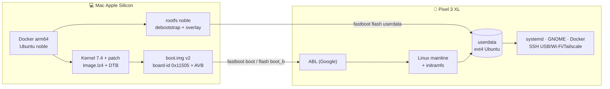

<div align="center">

# 📱 Ubuntu 24.04 native trên Google Pixel 3 XL

**Biến một chiếc Pixel 3 XL (crosshatch, Snapdragon 845) thành máy Ubuntu thật: kernel mainline, systemd, GNOME cảm ứng, Docker — không Android, không chroot.**

*Native Ubuntu 24.04 LTS (arm64) on the Google Pixel 3 XL with a mainline Linux kernel — reproducible scripts, kernel patches and field notes.*

-4285F4?logo=google&logoColor=white)


</div>

> ⚠️ **Thử nghiệm.** Cần mở khoá bootloader (xoá sạch dữ liệu). Làm sai phân vùng có thể **brick**. Đọc [Luật an toàn](#-luật-an-toàn) trước khi chạy bất cứ lệnh flash nào.

---

## ✨ Điểm nổi bật

- 🐧 **Ubuntu 24.04 thật** chạy từ phân vùng `userdata` (ext4), kernel **mainline 7.4** + series panel của David Heidelberg + **14 patch** riêng.
- 🖐️ **Tablet GNOME 46**: panel AMOLED bằng driver thật, cảm ứng, bàn phím ảo (cả Chrome), giữ lâu = chuột phải, né **tai thỏ**.
- 🔋 **Quản lý pin cho server 24/7**: giới hạn sạc (đang dùng **85–90 %**, chỉnh được), **sạc nhanh USB PD 9 V** (driver Type-C mới viết cho PMI8998), bảng dòng sạc theo nhiệt độ của Google.
- 🔊 **Loa stereo** (2× CS35L36), phím âm lượng, nút nguồn tắt/bật màn hình như điện thoại.
- 🌐 SSH qua **USB (NCM)**, **Wi-Fi**, **Tailscale**; Remote Desktop (xrdp); **Docker** chạy được → làm server game/web nhỏ ~0,7 W.
- 🔁 **Tái lập 100 %**: mọi bước build/flash là script trong [`scripts/`](scripts/), môi trường build Docker arm64 trên Mac Apple Silicon.

## ✅ Phần cứng — cái gì chạy

| Khối | Chip | Trạng thái | Ghi chú |
|---|---|:---:|---|
| CPU / cpufreq / nhiệt | SDM845 (4+4 Kryo 385) | ✅ | không bị hạ xung khi chạy server |
| Lưu trữ | UFS 64 GB | ✅ | rootfs trên `userdata` |
| Màn hình | AMOLED 1440×2960 (Samsung S6E3HA8) | ✅ | driver panel thật; ⚠️ **không được tắt panel** (xem dưới) |
| GPU | Adreno 630 (freedreno) | ✅ | GNOME Wayland tăng tốc phần cứng |
| Cảm ứng | Samsung S6SY761 | ✅ | patch DT riêng |
| Wi-Fi | WCN3990 (ath10k) | ✅ | firmware chạy trong modem |
| Bluetooth | WCN3990 | ✅ | cần gán địa chỉ BT (`pixel-bt-addr.service`), quét/ghép đôi qua GNOME |
| USB-C thiết bị | DWC3 | ✅ | gadget NCM (mạng) + ACM (serial) |
| **USB PD** | PMI8998 Type-C + PD PHY | ✅ | **driver mới**: sink 5 V/3 A, **9 V/2 A** |
| Sạc / pin | PMI8998 SMB2 + MAX17201 | ✅ | %, nhiệt, giới hạn sạc, sạc nhanh |
| Loa | 2× Cirrus CS35L36 | ✅ | PipeWire, phím âm lượng |
| Micro | WCD9340 (SLIMbus) | 🔴 | codec + SLIMbus lên, dữ liệu thu = 0 |
| Camera trước | Sony IMX355 | 🟡 | cảm biến nhận ở 0x10; chưa có ảnh (cần libcamera ≥ 0.3) |
| Camera sau | Sony IMX363 | ❌ | không có driver mainline |
| Rung | Cirrus CS40L20 | ❌ | không có driver mainline |
| 4G / modem dữ liệu | MPSS | ❌ | modem chạy (cho Wi-Fi), chưa có dữ liệu di động |
| Ngủ (suspend) | — | ❌ | tắt panel = treo máy; dùng "tắt màn hình mềm" |

Chi tiết từng linh kiện (GPIO, nguồn, firmware, thông số đo được): [`docs/hardware/`](docs/hardware/).

## 🧭 Kiến trúc



## 🚀 Bắt đầu nhanh

**Cần:** Pixel 3 XL bản **không phải Verizon**, đã bật *OEM unlocking*; Mac Apple Silicon + Docker Desktop + ~50 GB trống (ổ ngoài được); `android-platform-tools`.

```bash
scripts/00-workspace.sh                      # workspace case-sensitive (sparsebundle)
scripts/10-factory-image.sh <URL> <SHA256>   # factory image crosshatch (đường lui + firmware)
scripts/11-extract-firmware.sh && scripts/12-upstream-firmware.sh
scripts/20-build-env.sh build                # image Docker build
scripts/30-kernel.sh all                     # kernel + module + DTB (lần đầu ~35 phút)
scripts/40-initramfs.sh && scripts/50-rootfs.sh && scripts/55-tqftpserv.sh
scripts/60-bootimg.sh install                # boot.img
fastboot boot /Volumes/pixelwork/out/boot/boot-install.img   # LUÔN thử trong RAM trước
```

Rồi flash `userdata` + `boot_b`, cài desktop (`91-xrdp.sh`), Tailscale (`92`), Wi-Fi dự phòng (`93`), giao diện cảm ứng (`97`, `98`, `99`).
Toàn bộ quy trình, thời gian từng bước và cách cứu hộ: **[`docs/RUNBOOK.md`](docs/RUNBOOK.md)**.

## 🛠️ Thao tác hằng ngày

| Việc | Lệnh |
|---|---|
| SSH qua USB | `ssh ubuntu@172.16.42.1` |
| Xem pin | `pin` (hoặc `pin -w` theo dõi liên tục) |
| Giới hạn / sạc nhanh | `/etc/default/pixel-charge-limit` (`STOP`, `START`, `FAST`) |
| Nhật ký điện năng | `column -s, -t < /var/log/pixel-power.csv \| tail` |
| Về fastboot từ Ubuntu | `sudo sync; sudo systemctl reboot -ff --reboot-argument=bootloader` |
| Máy rơi về Android ("Cannot load Android system") | **KHÔNG factory reset** → Vol Down + Power → `fastboot --set-active=b` |
| Cập nhật giao diện cảm ứng | `export PIXEL_HOST=<ip>`; `scripts/97-chrome-osk.sh`, `98-gnome-shell-ext.sh`, `99-ding-longpress.sh` |

## 🧩 Patch kernel ([`kernel/patches/`](kernel/patches/))

| # | Patch | Loại |
|---|---|---|
| 0001 | TEXT_OFFSET 0x80000 trong header Image (ABL đòi) | HACK |
| 0002–0004 | DT: cảm ứng S6SY761, fuel gauge MAX1720x, loa CS35L36 + sound card | HACK DT |
| 0005 | **ASoC q6asm**: reset hàng đợi khi prepare lại (PipeWire kẹt sau 1 period) | sửa lỗi upstream-able |
| 0006 | **max1720x**: xoá cờ cảnh báo đúng cách (`health=Dead` giả) | sửa lỗi upstream-able |
| 0007, 0010, 0011 | DT: camera trước, WCD9340/micro, trần dòng sạc 3 A | HACK DT |
| 0008, 0009, 0014 | **qcom_smbx**: `charge_behaviour`, dòng vào theo Type-C Rp, dòng sạc chỉnh được, giữ giới hạn PD | tính năng mới |
| 0012 | **Type-C sink cho PMI8998 (SMB2)** → USB PD qua TCPM + PD PHY | driver mới |
| 0013 | DT: cổng USB PD (5 V/3 A, 9 V/2 A) | HACK DT |

Base: `v7.4-rc2` + series panel **v3** `20261108-crosshatch-panel-v3-0-87dd4ec4f7cc@ixit.cz`. Lý do từng option config: [`docs/software/kernel.md`](docs/software/kernel.md).

## 🧠 Bài học xương máu (đọc trước khi động vào máy)

- 🖥️ **Tắt panel S6E3HA8 = treo cứng → watchdog reset.** Mọi thứ tắt màn hình (idle, màn khoá, suspend) đều bị khoá; nút nguồn chỉ hạ backlight về 0.
- 🔁 **A/B slot**: Ubuntu phải tự đánh dấu "boot thành công" (`qbootctl`), không thì sau 3 lần boot ABL rơi về Android.
- 🧾 **board-id**: DTS mainline ghi `0x21505` (Pixel 3), ABL của 3 XL đòi **`0x11505`**.
- 🌐 Mạng USB **không được** cấp gateway/DNS cho máy tính, không thì máy tính mất Internet khi cắm điện thoại.
- ⌨️ Mutter 46 chỉ bật bàn phím ảo khi app gửi `text-input-v3 enable` **lần thứ hai** → Chrome cần extension bù.

Bảng lỗi đầy đủ → nguyên nhân → cách xử lý: [`docs/RUNBOOK.md` §4, §6](docs/RUNBOOK.md).

## 🔐 Luật an toàn

1. Chỉ flash `boot_a/b`, `dtbo_a/b`, `vbmeta_a/b`, `userdata`. **Không bao giờ** đụng `xbl`, `abl`, `aop`, `modem`, `persist`, `devcfg`…
2. **Luôn `fastboot boot` thử trước** khi flash.
3. **Không bao giờ `fastboot flashing lock`** khi đang chạy image không phải stock.
4. Giữ factory image (đường lui về Android): `scripts/10-factory-image.sh`.

## 📚 Tài liệu

| | |
|---|---|
| [`docs/RUNBOOK.md`](docs/RUNBOOK.md) | vận hành, SOP, bảng lỗi, sự cố reset |
| [`docs/hardware/`](docs/hardware/) | từng linh kiện: chip, GPIO, nguồn, driver, trạng thái |
| [`docs/software/`](docs/software/) | boot chain, kernel, firmware, rootfs/dịch vụ, truy cập từ xa, [giao diện cảm ứng](docs/software/touch-ui.md) |
| [`docs/ARCHIVE.md`](docs/ARCHIVE.md) | lưu trữ phụ thuộc (source, firmware, image) để dựng lại sau này |
| [`NOTES.md`](NOTES.md) | nhật ký kỹ thuật theo thời gian |

```
scripts/      quy trình build/flash/cấu hình (đánh số theo thứ tự)
kernel/       patch + fragment config
rootfs/       overlay hệ thống, extension GNOME tự viết
initramfs/    init tối giản (tìm rootfs, cứu hộ)
docker/       môi trường build arm64
docs/         tài liệu phân cấp
archive/      bản lưu trữ (file lớn bị .gitignore)
```

## 🗺️ Việc tiếp theo

- [ ] Micro (SLIMbus → DSP trả 0) · [ ] Camera trước (sửa DT + libcamera soft ISP)
- [ ] Ngủ thật: sửa trình tự tắt/bật panel · [ ] Giữ lâu = chuột phải cho mọi app (uinput)
- [ ] Gửi upstream các bản sửa q6asm / max1720x / qcom_smbx / Type-C PMI8998

## 🙏 Ghi công

- **David Heidelberg** và cộng đồng **sdm845-mainline** — DTS Pixel 3/3 XL và driver panel AMB630QY01.
- **postmarketOS**, **linux-msm** (`qrtr`, `rmtfs`, `tqftpserv`, `qbootctl`), **Linaro** (khung Qualcomm Type-C/TCPM, DB845c làm mẫu).
- Thông số phần cứng tham chiếu từ DT gốc của Google (factory image) và mã nguồn kernel Android (chỉ đọc).

## 📄 Giấy phép

Patch kernel theo **GPL-2.0** như kernel Linux. Script và tài liệu: *chưa chọn giấy phép* (dự kiến MIT/CC-BY). Firmware Qualcomm/Google là độc quyền,
**không** nằm trong repo (`archive/` bị `.gitignore`); script tự trích từ factory image chính chủ. Trước khi công khai: [`docs/PUBLISHING.md`](docs/PUBLISHING.md).
